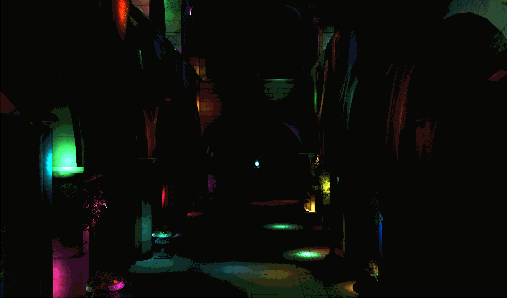
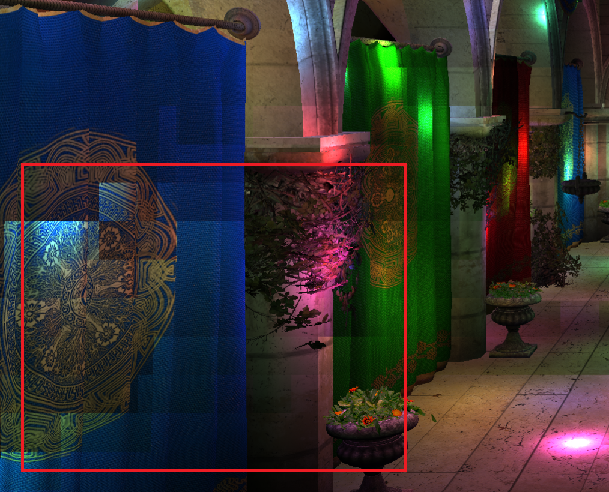
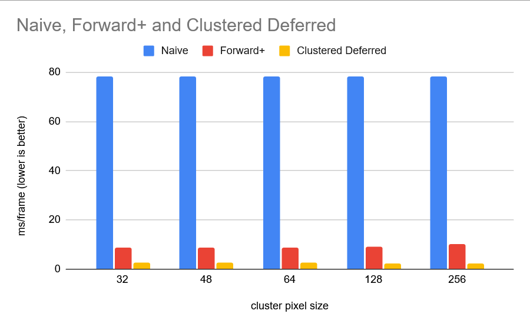
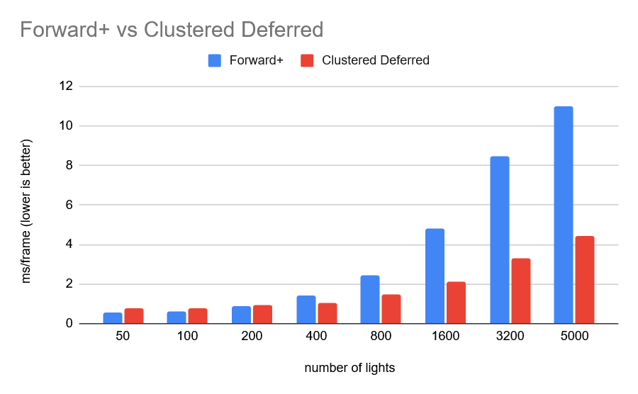
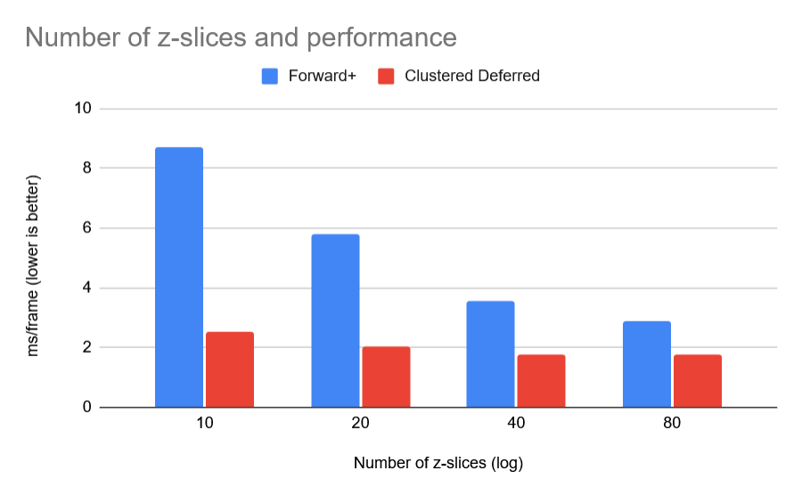
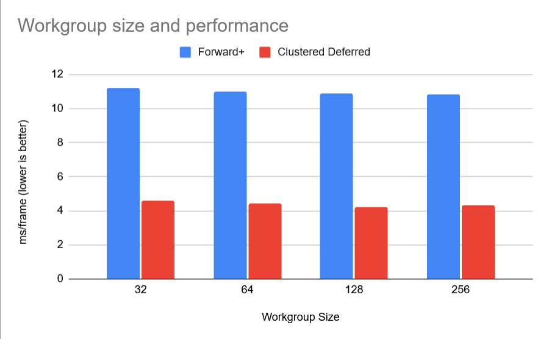

WebGL Forward+ and Clustered Deferred Shading
======================

**University of Pennsylvania, CIS 565: GPU Programming and Architecture, Project 4**

* T Fong
  * [LinkedIn](https://www.linkedin.com/in/tzfong/), [personal website](https://www.tzfong.com/)
* Tested on: Windows 11, Intel Ultra9 275HX (2.70 GHz), RTX 5070 Mobile, 32 GB RAM (5600 MT/s)

### The problem with lights
How do you handle lights in a rasterized real-time program? You don't have the luxury of accumulating samples over many frames; each frame, the fragments need to reflect the influence of the lights.

For our purposes here, lights are point lights, with a position, color, and a shared radius of influence.

### The naive approach
The most obvious approach is for each fragment, to simply iterate over all of the lights, and accumulate the light contributions for each light. This would work okay for a low number of lights, but you can imagine it quickly getting out of hand as the lights begin to number in the dozens or hundreds.

### Light clustering
We can divide our view frustum into a bunch of clusters (mini-frustums). Each of these clusters occupy some region of the screen, which I've parametrized with `clusterPixelSize`, and will profile later. Clusters also are constrained to some range of z values, which we control by determining how we slice the frustum (linear or log), and how many slices we take.

We can compute the areas that each light affects, pruning the number of lights each fragment has to check, by, in a compute shader, where workgroups are assigned to clusters, computing the view space bounding box of the cluster, and iterating over the lights to see if the influence sphere of the light intersects the cluster's bounding box. If it does, we add it(s index) to the cluster (stopping at some maximum light per frustum count, since a cluster does not occupy an arbitrarily large amount of memory). When I was starting, linear slices seemed the intuitive choice, but I believe log slices often look better because it causes more clusters to be closer to the camera, and therefore you're less likely to drop lights.

If there are too many lights per cluster (either the max cluster size isn't big enough, the clusters themselves are too big, or there are just too many lights) you start seeing these artifacts.

### Forward+ rendering
There are more sophisticated optimizations for forward+, such as doing a z-prepass to eliminate clusters that aren't visible (...but at that point, why even call it forward+...?), but clustering the lights based on clusters of the view frustum is the crux of it. Now for our fragment shader, we compute the view space position of the fragment, calculate its cluster, then loop over only the lights in the cluster.

### Clustered-deferred rendering
Because fragments are processed in parallel, we don't have a notion of ignoring fragments that will get overwritten by a closer fragment. This isn't a problem where the fragment shader is simple, but is suboptimal for expensive lighting calculations. While we're not doing anything *too* fancy here, we probably wouldn't want to iterate over a bunch of lights for fragments we won't even end up seeing.

Deferred rendering addresses this problem (and allows to perform other previously impossible effects, which is beyond the scope of *this* project but is something I've worked on [here](https://www.tzfong.com/technical/pbr_deferred_renderer/)) with a simple idea: we write the data of only the fragments we see, then perform a second pass where we shade using those fragments' data.

This does come with some tradeoffs, like making anti-aliasing harder, or making transparency harder, or (probably most importantly) its increased memory usage, but only the last one is a problem here, and the increased memory usage isn't too big a problem on a gaming laptop.

The way we store the fragment data is by writing it to a series of textures we collectively call the g-buffer. What the g-buffer needs to contain will vary with your application; here we only need the fragment's (world space) position, normal, and its albedo.

Once we've written the visible geometry data into our g-buffer, we can perform the clustered lighting calculations in the second pass, only on the fragments that matter, by rendering on a quad, where each fragment loads the g-buffer data at its position on the screen.

### Demo video

### Performance
#### A note on methodology
Benchmarks were taken on Google Chrome, Version 155.0.8059.85. Chrome typically caps the fps to the display refresh rate, but I found that bypassing it made it very difficult to interact with, even though the fps was much higher and should've been more responsive!

So with the help of an agent, I got the frame times with a GPUFrameTimer, and obtained the benchmarks by averaging over an interval of 1000 frames after the first warmup 1000 frames. Since as you might expect, the runtime of the naive implementation blows up as the number of lights increases, I did not take too many benchmarks.

My first benchmark, where I had 10 slices, a cluster size of 32x32 pixels, a max of 100 lights per cluster, and 64 threads per workgroup, yielded at 5,0000 lights

| Renderer | Avg. frame time (ms) |
| :-- | --: |
| Naive | 395.613 |
| Forward+ | 12.383 |
| Clustered Deferred | 2.886 |

This is to say, naive predictably performed poorly, though the comparison was a little unfair, because the low slice count and max lights meant the clusters were frequently hitting the limit and as a result, not iterating cumulatively as many lights as the naive (more on this in a second).

I increased the max number of lights per cluster to 150, then profiled the change in performance of altering the cluster pixel size:

That second has arrived, and here's a more fair comparison between forward+ vs clustered deferred. I think ideally you would set the max number of lights per cluster as a function of the number of clusters and teh number of slices, but this time I set the max to 150 and the number of slices to 80, somewhat mitigating the ignoring of lights (though some artifacts were still visible).

The results aren't too surprising; at low light count, forward+ eeks out ahead of clustered-deferred, as clustered-deferred takes a whole nother pass that must occur strictly ahead of the actual lighting pass, and the number of fragments saved the expensive lighting calculations isn't worth it, especially considering most light sources are being affected by many lights in the first place. But clustered-deferred pretty quickly takes over.

Since naive doesn't use the clusters, it doesn't move the needle. But there was an increase in performance at around 64 pixels. I believe this is because there'd be less warps in which the threads would be looping over different light lists, while the number of lights isn't too great so as to incur a big cost increase for threads having to loop over more lights.

We can observe that at 5,000 lights, here clustered-deferred takes 4.408 ms, up from the 2.886 observed in my initial benchmark.

I also profiled the effects of varying the number of z-slices.

Once again, it seems intuitive that increasing the number of slices would give you better performance, as by increasing the granularity of the slice each fragment tests against a more precise set of potentially relevant lights. The tradeoff being that it costs more memory.

I also profiled how workgroup size affects performance.

The configurations I tested seemed to only have a modest effect on performance. The sweet spot was around 128 or 256, and it would make since that larger workgroups would increase performance by way of making looping over the lights in the scene faster per cluster.

### Credits

- [Vite](https://vitejs.dev/)
- [loaders.gl](https://loaders.gl/)
- [dat.GUI](https://github.com/dataarts/dat.gui)
- [stats.js](https://github.com/mrdoob/stats.js)
- [wgpu-matrix](https://github.com/greggman/wgpu-matrix)
